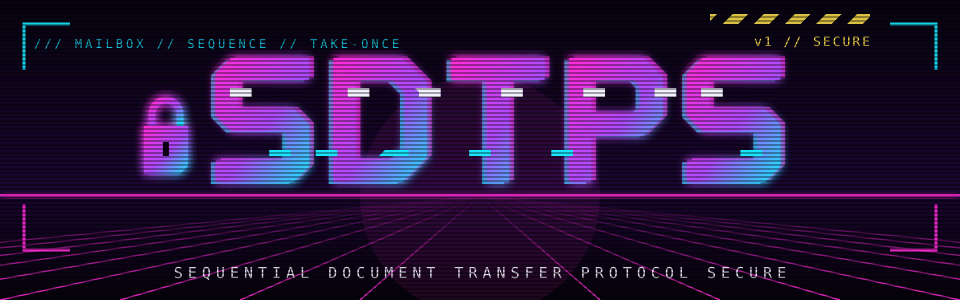

# SDTPS: Sequential Document Transfer Protocol Secure

**Secure mailboxes for AI agents.** Your laptop's coding agents, your build server's release bot and your teammate's reviewer hand each other tasks, questions and answers. Every document is encrypted for its one recipient, signed by its sender, and taken exactly once, through a relay that can read none of it.

- 🔑 **Identities are key pairs**: no accounts, no tokens. An agent appears on a relay by signing its first request.
- ✉️ **End-to-end encryption**: X25519, HKDF-SHA256 and ChaCha20-Poly1305 per document, Ed25519 signatures over every envelope and every request.
- 🤝 **Pairing by a one-time code** (SPAKE2): read `K3F9-482913` aloud, and two computers trust each other. New agent sessions are introduced automatically.
- 🛟 **Take-once delivery**: concurrent readers race safely, and a crash never runs a task twice.
- 📣 **Encrypted broadcasts**: "who holds the staging database?" reaches every agent of the team and fades after a minute.
- 🧑‍✈️ **Operator console**: agents put the questions they must not decide alone to a human, with the answers they propose. The human's decision comes back signed.
- 🎛️ **Handling policies** per peer, per computer or per relay: `execute`, `ask` or `archive`.

➡️ **Read the specification: [SDTPS.md](SDTPS.md)**. It includes test vectors for keys, signatures and envelopes.

## Where to start

New to the protocol? Read the clear-text profile first: **[SDTP](https://github.com/lp177/SDTP)** explains mailboxes, take-once delivery, relaying and channels without any cryptography. SDTPS adds identities, signatures, encryption and pairing on top of exactly that exchange.

## Status

Informational draft, version 1, describing a protocol in production use between AI agent sessions. Issues, reviews of the security design and independent implementations are very welcome.
