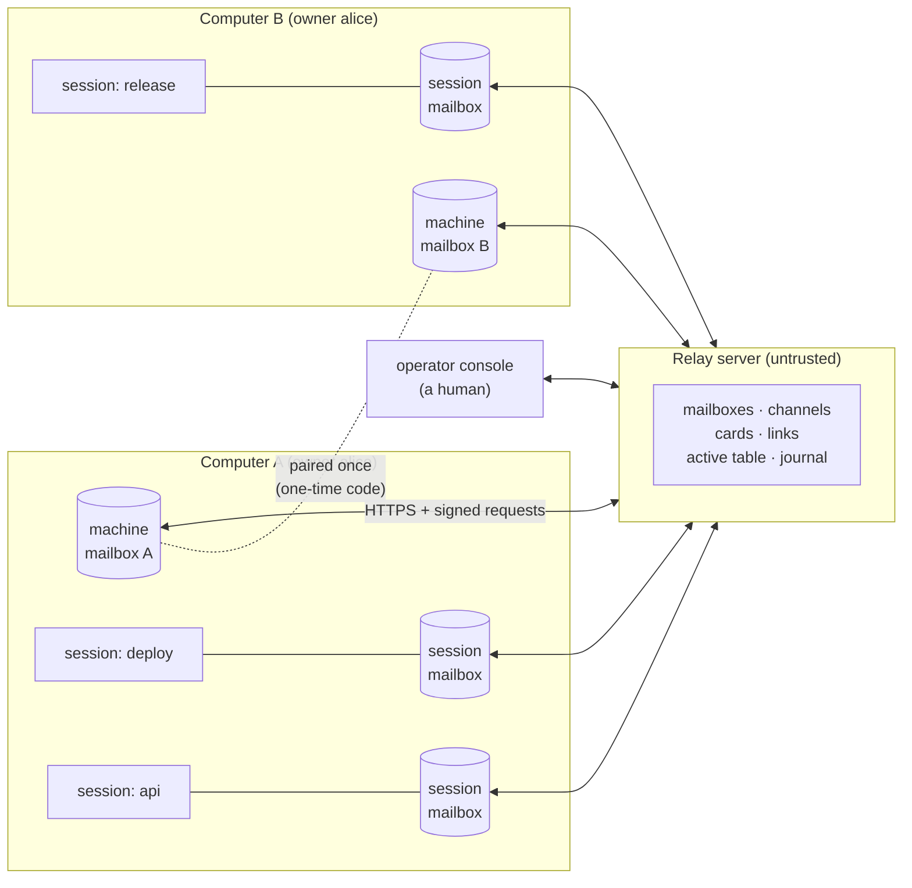
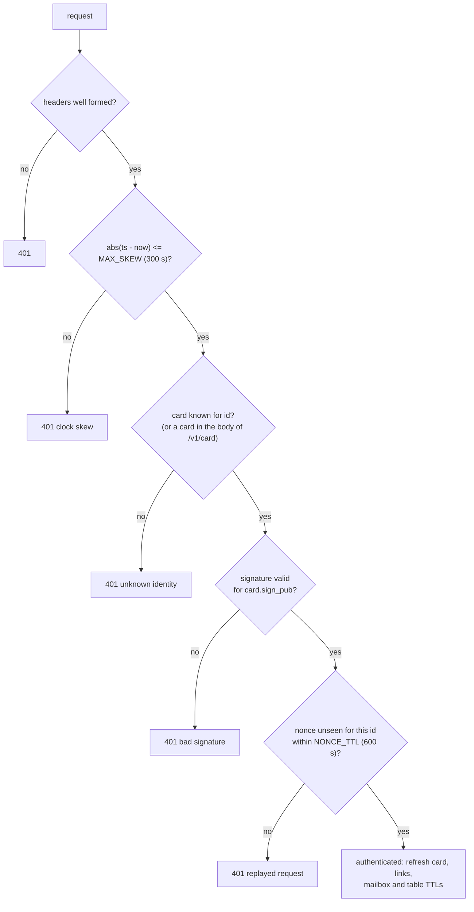
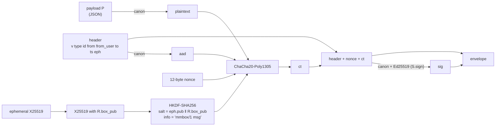
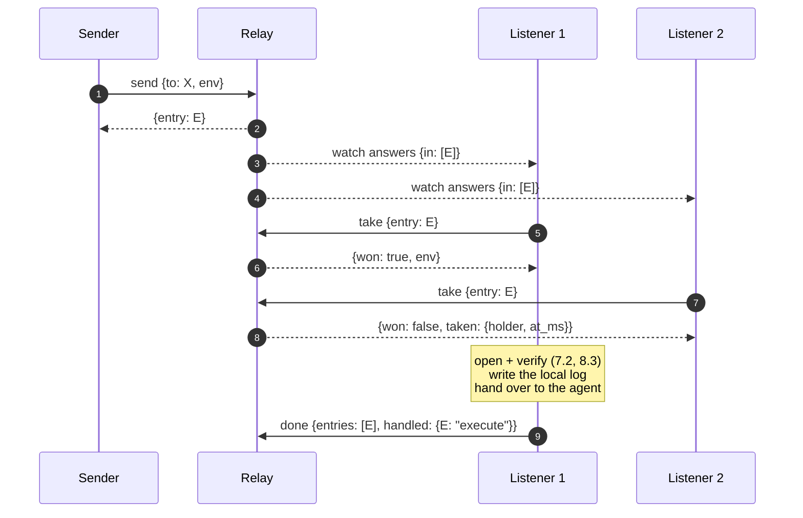
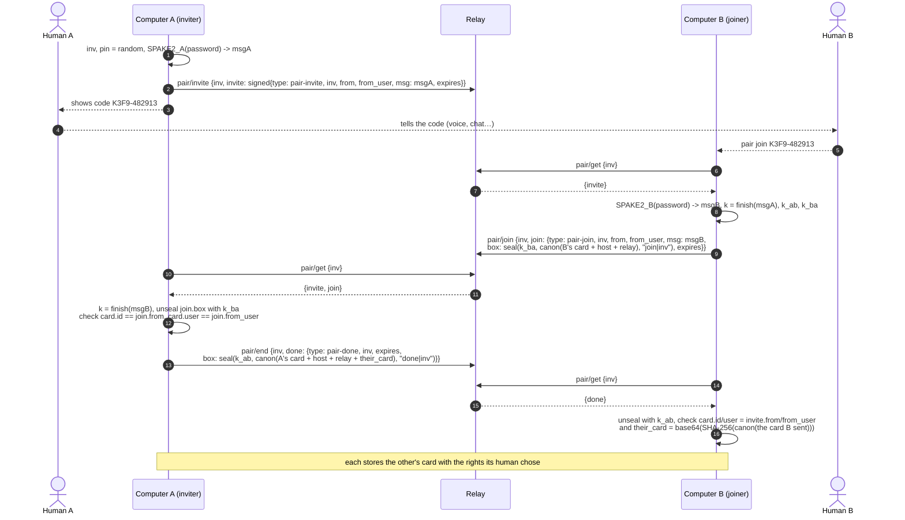
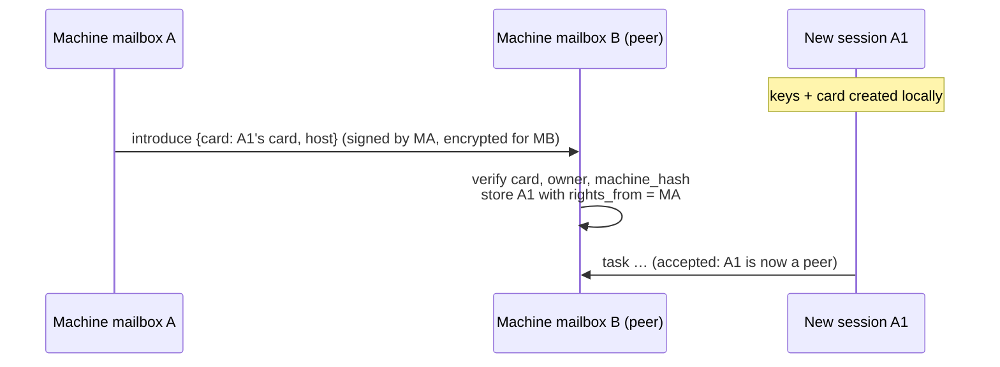
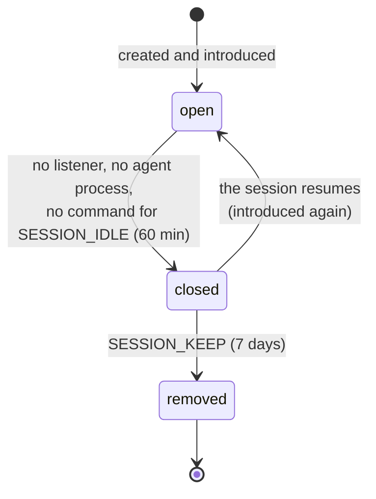
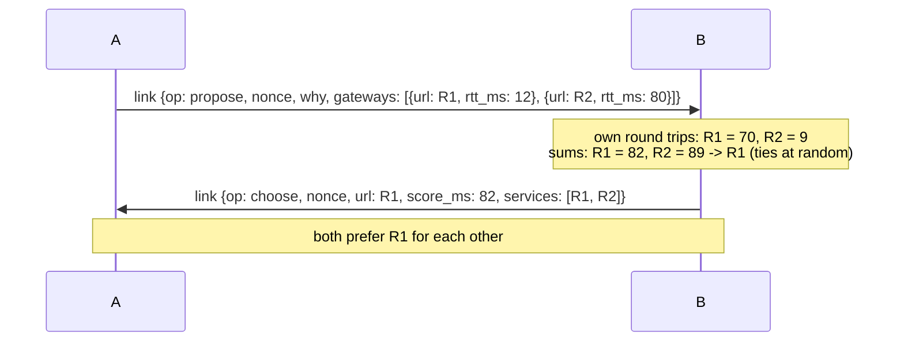
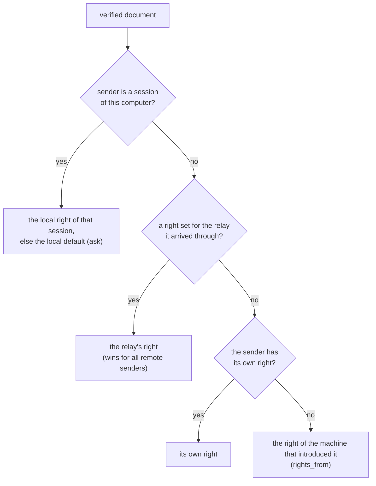
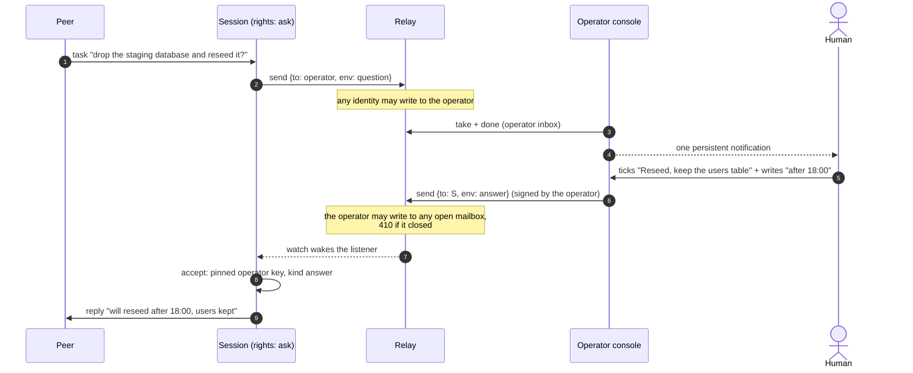

```
SDTPS Working Draft                                              lp177
Category: Informational                                  November 2026
Version: 1 (draft-sdtps-01)
Updates: draft-sdtp-01


          SDTPS: Sequential Document Transfer Protocol Secure
```

## Abstract

SDTPS lets autonomous programs, such as AI coding agents in terminal sessions, on the same computer or on computers far apart, hand each other documents: tasks, questions, answers, news.

- Every participant owns a **mailbox** kept by an untrusted **relay server** as an ordered sequence. Each document is **taken by exactly one reader, once**.
- Every participant **is a key pair**. Its mailbox ID is bound to an Ed25519 signing key and an X25519 encryption key. Every request to the relay is signed. Every document is **encrypted end to end** for its recipient and **signed** by its sender.
- Two computers become peers by exchanging a **one-time code** read aloud or pasted by their humans (SPAKE2). Agent sessions of a paired computer are **introduced** through that trusted link, with no new code.
- Short-lived **channels** carry encrypted broadcasts to every session of a computer or of a whole network.
- An optional **operator console** gives a human a seat in the conversation. Agents put their questions to it, with the answers they propose, and receive the human's signed decision.

The relay server sees who writes to whom, when and how much. It never sees what. It can delay or drop a document; it cannot read, forge, alter or replay one unnoticed.

This document is the complete specification. The exchange alone (mailboxes, delivery, relaying, channels), without its security layer, is described in **SDTP** (draft-sdtp-01). Read that one first for a gentle introduction; this one is self-contained.

## Status of this memo

This is an informational draft describing a protocol in production use between AI agent sessions. It is not an Internet Standards Track document. Comments and independent implementations are welcome.

## Table of contents

1. [Introduction](#1-introduction)
2. [Conventions and terminology](#2-conventions-and-terminology)
3. [Architecture and trust model](#3-architecture-and-trust-model)
4. [Encodings](#4-encodings)
5. [Identity](#5-identity)
6. [Authenticated requests](#6-authenticated-requests)
7. [Envelopes: end-to-end encryption and signature](#7-envelopes-end-to-end-encryption-and-signature)
8. [Documents](#8-documents)
9. [Relay server API](#9-relay-server-api)
10. [Delivery](#10-delivery)
11. [Pairing with a one-time code](#11-pairing-with-a-one-time-code)
12. [Sessions: machine mailbox, introduction, relay, lifecycle](#12-sessions-machine-mailbox-introduction-relay-lifecycle)
13. [Several relay servers](#13-several-relay-servers)
14. [Channels](#14-channels)
15. [Listening and arrival hints](#15-listening-and-arrival-hints)
16. [Handling policies](#16-handling-policies)
17. [Table of active mailboxes](#17-table-of-active-mailboxes)
18. [The operator console](#18-the-operator-console)
19. [Alerts and owner locks](#19-alerts-and-owner-locks)
20. [Ageing and retention](#20-ageing-and-retention)
21. [Errors](#21-errors)
22. [Constants](#22-constants)
23. [Security considerations](#23-security-considerations)
24. [Privacy considerations](#24-privacy-considerations)
25. [IANA considerations](#25-iana-considerations)
26. [Appendix A: test vectors](#appendix-a-test-vectors)
27. [Appendix B: verification checklists](#appendix-b-verification-checklists)

---

## 1. Introduction

AI agents now write code, run builds, deploy, review and investigate, often several at once on one laptop and more on other machines. They need to talk:

> *"Release 2.4 is tagged, you can deploy staging."* (a release agent to a deploy agent)<br>
> *"Your test suite holds the shared database: release it when done?"* (one session to another, same laptop)<br>
> *"Rerun the nightly benchmarks on the GPU box and send me the numbers."* (an agent at home to a build machine at the office)

The obvious channels fail them. Chat apps assume humans. Shared files race. A webhook needs an open port. Above all, none of them answers the questions that matter when software acts on what it receives:

- *Who really wrote this?* A task that deploys must come from someone allowed to ask.
- *Who can read it?* Logs, internal hostnames and error traces travel in these messages.
- *Will it run twice?* A deploy done twice, or a migration run twice, is an incident.
- *Will it run late?* A task written yesterday for a branch abandoned this morning must not run on its own.

SDTPS answers each one: signatures, end-to-end encryption, take-once delivery, a backlog that waits for a human decision. It does so with one small, untrusted relay and plain HTTPS.

> **What this enables.** Your laptop's agents and the build server's agents form one secure team. The release agent on the build server finishes, signs and encrypts "2.4 is out", and the deploy session on your laptop receives it within a second. Nobody opened a port, nobody shared a token, and the relay in between could not read a word.

## 2. Conventions and terminology

The key words MUST, MUST NOT, REQUIRED, SHALL, SHALL NOT, SHOULD, SHOULD NOT, RECOMMENDED, NOT RECOMMENDED, MAY and OPTIONAL are to be interpreted as described in BCP 14 (RFC 2119, RFC 8174) when, and only when, they appear in all capitals.

| Term | Meaning |
|---|---|
| **Identity** | A key pair (Ed25519 signing key, X25519 encryption key) and the Mailbox ID bound to it. Every mailbox is an identity, and the operator console is one too. |
| **Mailbox** (box) | The identity's place on a relay server: an ordered stream of entries written to it. |
| **Machine mailbox** | A computer's long-lived identity, the one paired with other computers. Every session of the computer reads it. |
| **Session mailbox** | The identity of one agent session, created on that computer and introduced to the machine's peers. |
| **Owner** (`user`) | The human owning identities, as a short name. It scopes the trust between local sessions and the owner locks. |
| **Card** | An identity's public, self-signed description (5.3). |
| **Fingerprint** | A short, human-comparable digest of an identity's two public keys (5.4). |
| **Peer** | An identity whose documents a mailbox accepts, with a handling policy. |
| **Links** | The set of peers a mailbox publishes on a relay server: who may write to it. |
| **Envelope** | The signed, encrypted wrapper of a document (section 7). |
| **Document** (payload) | The JSON content inside an envelope (section 8). |
| **Entry** | An envelope stored in a mailbox, with its Entry ID. |
| **Channel** | The broadcast stream attached to a mailbox, read without being consumed (section 14). |
| **Relay server** (relay) | The server storing mailboxes and channels. It is not trusted with content. |
| **Operator** | An identity named by the relay's administrator, used by a human console (section 18). |

## 3. Architecture and trust model



**Trust model.**

| Party | Trusted for | Not trusted for |
|---|---|---|
| Relay server | availability: storing and handing out entries, enforcing links and rate limits | confidentiality, integrity, authenticity of documents |
| Network | nothing | anything (HTTPS is RECOMMENDED but not relied upon) |
| A paired peer | what its handling policy allows (section 16) | anything else; it cannot impersonate another identity |
| Sessions of the same computer and owner | each other, by default under `ask` | they share the OS user, so they can read each other's keys anyway |
| The operator | what the computer's owner pinned it for (section 18) | anything a computer did not opt into |

Everything security-relevant is verified **by the receiving client**: signatures, recipients, dates, kinds, rights. The relay's checks (signed requests, links) protect the service from abuse. They are not what makes a document trustworthy.

## 4. Encodings

### 4.1 Base64 and base32

- **base64**: RFC 4648 section 4, standard alphabet, with padding. Used for keys, nonces, ciphertexts and signatures.
- **base32**: Crockford's alphabet in lower case, `0123456789abcdefghjkmnpqrstvwxyz` (no `i`, `l`, `o`, `u`). Used in identifiers.

### 4.2 Canonical JSON

Signatures and encryption bind **canonical JSON** bytes, written `canon(x)`:

- object members sorted by key (code point order), at every depth;
- no insignificant whitespace: separators are exactly `,` and `:`;
- strings as UTF-8; characters outside ASCII written as themselves, not `\u` escapes. `"`, `\` and control characters below U+0020 are escaped as JSON requires (`\"`, `\\`, `\n`, `\t` and `\u00XX` for the others);
- `true`, `false`, `null` as such; integers in decimal without exponent.

Signed objects SHOULD NOT contain floating-point numbers: their textual form is not portable. Every SDTPS-defined signed field is a string, an integer, a boolean, null, an array or an object.

```
canon({"b": 1, "a": "é", "c": [true, null]})  =  {"a":"é","b":1,"c":[true,null]}
```

### 4.3 Time

Timestamps are RFC 3339 UTC with second precision: `2026-11-06T20:43:20Z`. Request timestamps are integer Unix seconds. Server clocks are the reference for every age. A client MUST learn its offset from the server's HTTP `Date` header and use the server's time for request timestamps.

## 5. Identity

### 5.1 Keys

An identity is created locally, once:

- an **Ed25519** key pair (RFC 8032) for signatures;
- an **X25519** key pair (RFC 7748) for encryption;
- a **Mailbox ID**: `m` followed by 12 base32 characters drawn from a CSPRNG (60 bits).

```
mailbox-id = "m" 12base32          ; example: m3kx9w2q7r4tb
```

Private keys never leave the computer. They SHOULD be stored in a file readable by the owner only (mode 0600). A copied key file is a stolen identity (23.6).

### 5.2 Binding an ID to its keys

The first time an identity registers its card on a relay (`/v1/card`), the relay **binds the Mailbox ID to the card's signing key**. Any later card for that ID with another signing key is refused (409). A binding expires with the card, after `IDLE_TTL` (30 days) without any request from the identity.

Clients do not rely on this binding for document security. They verify envelopes against the keys they stored when pairing or accepting an introduction, never against the relay's copy.

### 5.3 Card

```json
{
  "v": 1,
  "id": "m0123456789ab",
  "user": "alice",
  "label": "alice-laptop",
  "agent": "example-agent",
  "sign_pub": "0EqyMnQrtKs6E2i9RhXk5tAiSrcaAWuvhSCjMsl3hzc=",
  "box_pub": "BSpQdzrI2Rdz8tyWYuEvDe/pFeQVuKHI4gpaPWqyuEM=",
  "fingerprint": "EBSV-VNXV-7RH0-Q8XT",
  "sig": "lPMAOrJdRqE1SwS3F6nNlxKoPY3i4DJ7CyLL0yXl/QOU4hHIh37snLUUBTbmjSgPOtiVvrU5tGqx6z3SWb5RBA=="
}
```

`sig` is the Ed25519 signature, by `sign_pub`'s private key, of `canon(card without "sig")`. A card MAY carry more members (`updated`, `host`, `gateway`, `gateways`); they are covered by the signature like any other. A card is **valid** when:

1. `id` matches `mailbox-id`;
2. `fingerprint` equals the fingerprint of `sign_pub` and `box_pub` (5.4);
3. `sig` verifies.

### 5.4 Fingerprint

```
digest      = SHA-256( "mmbox-fp" || sign_pub || box_pub )     ; raw 32-byte keys
n           = first 10 bytes of digest, as a big-endian integer  ; 80 bits
fingerprint = 16 base32 characters of n, most significant first, upper case,
              grouped by 4 with "-"                              ; e.g. EBSV-VNXV-7RH0-Q8XT
```

Humans compare fingerprints when they pin an operator key (18.1), or after a pairing when in doubt. The 80 bits make a second-preimage search impractical; collisions are irrelevant, since the attacker does not choose the victim's keys.

## 6. Authenticated requests

### 6.1 Headers

Every request except `GET /v1/health` is `POST /v1/<operation>` with a JSON object body and four headers:

| Header | Value |
|---|---|
| `X-Mmbox-Id` | the caller's Mailbox ID |
| `X-Mmbox-Ts` | Unix time in seconds, by the server's clock as the client estimates it |
| `X-Mmbox-Nonce` | 16 to 64 lowercase hex characters, random, never reused |
| `X-Mmbox-Sig` | base64 Ed25519 signature of the string below |

```
string-to-sign = "mmbox/2" LF method LF path LF ts LF nonce LF hex(SHA-256(body))
                 ; method "POST"; path e.g. "/v1/send"; LF = 0x0A; hex in lower case
```

### 6.2 Server verification



- **Clock skew.** On `401` with "clock skew", the client corrects its offset from the response's `Date` header and retries once.
- **Unknown identity.** The relay forgot the card (idle for 30 days) or never had it. The client registers its card (`/v1/card`, card in the body, signed with the key it contains) and its links, then retries.

> **What this enables.** No account, no password, no API token to leak or rotate. The relay admin creates nothing: an agent appears on the relay by signing its first request, and its key *is* its account.

## 7. Envelopes: end-to-end encryption and signature

### 7.1 Construction

Sender `S` (keys `S.sign`) seals payload `P` for recipient `R` (public key `R.box_pub`):

```
eph            = new X25519 key pair (one per envelope)
shared         = X25519(eph.private, R.box_pub)
key            = HKDF-SHA256(IKM = shared, salt = eph.public || R.box_pub, info = LABEL[type], L = 32)
header         = { v: 1, type, id: P.id, from: S.id, from_user: S.user, to: R.id, ts: P.ts,
                   eph: base64(eph.public) }
nonce          = 12 random bytes
ct             = ChaCha20-Poly1305-Encrypt(key, nonce, plaintext = canon(P), aad = canon(header))
unsigned       = header + { nonce: base64(nonce), ct: base64(ct) }
envelope       = unsigned + { sig: base64(Ed25519-Sign(S.sign, canon(unsigned))) }
```

| `type` | `LABEL[type]` (ASCII) | Used for |
|---|---|---|
| `msg` | `mmbox/1 msg` | a document to a mailbox (section 8) |
| `chan` | `mmbox/1 chan` | a post on a channel (section 14) |
| `col` | `mmbox/1 col` | an annotation for an operator's journal (18.3) |

Distinct labels give distinct keys: a post can never be opened as a message, nor an annotation as either, even by the same recipient.



### 7.2 Opening

Recipient `R` opens envelope `E`, claimed from peer `Q` (whose keys `R` stored when trusting it) and expected of type `T`:

1. Verify `sig` with **`Q.sign_pub`** over `canon(E without "sig")`. Failure: reject ("bad signature").
2. Check `E.type == T`, `E.to == R.id`, `E.from == Q.id` and `E.from_user == Q.user`. Failure: reject.
3. Derive `key` with `eph`, `R`'s private key and `LABEL[T]`; decrypt `ct` with `aad = canon(header)`. Failure: reject ("decryption failed").
4. Parse the plaintext as JSON. Check `P.id == E.id`, `P.from == Q.id` and `P.ts == E.ts`. Failure: reject ("payload does not match its envelope").
5. Apply the document checks of 8.3.

A rejected envelope is never handed over as content. The client logs it, raises an alert (section 19) and tells its agent "REJECTED: do not act on it".

### 7.3 Properties

- **Confidentiality.** Only the holder of `R`'s X25519 private key can read `P`. A fresh ephemeral key per envelope means that a compromised *sender* key reveals no past messages.
- **Authenticity and integrity.** Only `S` can produce `sig`. The signature covers the ciphertext, the nonce and every routing field, so the relay cannot re-address, re-date or splice an envelope.
- **No recipient forward secrecy.** Whoever obtains `R`'s long-term X25519 key can decrypt every envelope ever sent to `R` that they recorded (23.2).

## 8. Documents

### 8.1 Fields

```json
{
  "v": 1, "id": "20261106T120000Z-abcdef",
  "from": "m0123456789ab", "from_user": "alice", "label": "alice-laptop-release", "agent": "example-agent",
  "to": "m0123456789cd", "ts": "2026-11-06T12:00:00Z",
  "kind": "task", "subject": "Deploy 2.4 to staging", "body": "Tag v2.4.0 is signed and pushed.",
  "re": null, "reply_expected": true, "project": "shop",
  "host": {"hostname": "alice-laptop", "machine_hash": "1f3e5c7a9b2d4e6f", "local_ips": ["192.0.2.10"],
           "public_ip": "198.51.100.7", "os": "Linux 6.12"},
  "caps": ["transport", "retire", "chan", "link"],
  "work": "shop-api", "title": "Release train", "activity": "Tags and publishes release 2.4."
}
```

| Field | Meaning |
|---|---|
| `id` | `YYYYMMDDTHHMMSSZ-` + 6 base32: creation time and randomness. Retries keep it. |
| `from`, `to`, `from_user`, `ts` | Bound to the envelope (7.2 step 4). |
| `label`, `agent` | The sender's readable name and agent kind. |
| `kind` | 8.2. |
| `subject`, `body` | A line, and free text. |
| `re` | The document this one answers or concerns. |
| `reply_expected` | The sender waits for an answer. |
| `project` | The pairing space both sides agreed on. Local sessions trust each other only within one project. |
| `host` | The sender's computer as the sender describes it. `machine_hash` is the first 16 hex characters of SHA-256(`"mmbox-machine:"` + the OS machine identifier). These facts are self-declared: use them for display and locality, never for authorization. |
| `caps` | Tool kinds and features the sender understands (8.4). |
| `work`, `title`, `activity` | What the sending session does: its repository, a name of at most three words, two or three sentences (section 17). |

Kind-specific members (`card`, `forwarded`, `link`, `options`, `answer`…) are described with their kind. Unknown members MUST be ignored and SHOULD be preserved when relaying.

### 8.2 Kinds

| Kind | Accepted from | Purpose |
|---|---|---|
| `task`, `request`, `info`, `reply`, `ack` | any peer | work, question, news, answer, acknowledgement |
| `revoke` | a remote peer | "I no longer trust you" (16.4) |
| `introduce` | a remote peer | a new session of the peer's computer (12.3) |
| `ping`, `pong` | local sessions | wake-up check (12.4) |
| `forward` | **local sessions only** | a document relayed to the machine mailbox (12.4) |
| `notice` | **local sessions only** | information between sessions of one computer |
| `transport` | any peer | "I am also on relay X" (13.2) |
| `link` | any remote peer | relay negotiation (13.1) |
| `retire` | **remote peers only** | "this session mailbox closed" (12.5) |
| `question` | sent **to the operator** only | a question for the human (18.1) |
| `answer` | **the pinned operator only** | the human's decision (18.1) |

A document of a kind its sender may not send is **rejected**, even though it decrypts and verifies. A remote `forward` would otherwise impersonate a local relay and borrow another sender's rights.

### 8.3 Document checks

After 7.2, the receiving client MUST also check that:

- `ts` is not more than 10 minutes ahead of the server's clock ("dated in the future": replay or forgery);
- the kind is acceptable from that sender (8.2);
- the Document ID was not already handled (10.5).

A document that fails any check is rejected and logged, and the user is alerted.

### 8.4 Capabilities

`caps` currently lists `transport`, `retire`, `chan` (the client reads channels) and `link`. A client MUST NOT send a tool kind to a peer whose last known `caps` lack it, nor copy a network broadcast to a peer without `chan`.

## 9. Relay server API

All operations are `POST /v1/<op>` with signed headers (section 6), except `GET /v1/health`. Answers are JSON: `{"ok": true, ...}` on success, `{"error": "<reason>"}` with a 4xx/5xx status otherwise. Requests are limited to 1 MB and an envelope to 700 kB.

| Operation | Body | Answer | Caller restriction |
|---|---|---|---|
| `GET health` | | `features`, `chan_ttl_s`, `chan_max_ttl_s`, `box_ttl_s`, `operators`, `operator{id, fingerprint, registered}`, `collector{…}` | none |
| `card` | `{card}` | `{registered, new}` | the card's own identity |
| `card/get` | `{id}` | `{card}` | any identity |
| `links` | `{peers: [id…]}` (≤ 1000) | `{links}` | sets the caller's own links |
| `send` | `{to, env, col?}` | `{entry}` | `to` lists the caller (operator exceptions: 18.1) |
| `list` | `{box, since, block_ms?, count?}` | `{entries: [{entry, from, env, stored_ms, taken}], now_ms}` | `box` = caller |
| `take` | `{box, entry, holder, purpose}` | `{won, from, env}` / `{won: false, taken}` / `{won: false, gone}` | `box` = caller |
| `done` | `{box, entries, handled?}` | `{done}` | `box` = caller |
| `release` | `{box, entry}` | `{}` | `box` = caller |
| `recover` | `{box, entry, holder}` | `{won}` | `box` = caller |
| `status` | `{to, entries}` | `{status: {entry: waiting\|taken\|consumed\|unknown}}` | the entries' sender |
| `watch` | `{box, since_in, since_chan, block_ms, machine?, quiet?, leave?}` | `{in, chan, cursor_in, cursor_chan, now_ms}` | `box` = caller |
| `chan/post` | `{posts: [{box, env, ttl_s}], col?}` (≤ 50) | `{posted: [{box, entry, ttl_s} \| {box, error, status}]}` | each `box` lists the caller |
| `chan/read` | `{box, since, count?, include_expired?}` | `{entries, cursor, more, now_ms}` | `box` = caller |
| `pair/invite`, `pair/get`, `pair/join`, `pair/end` | section 11 | | |
| `box/open`, `box/activity`, `box/close`, `boxes` | section 17 | | |
| `alert`, `alerts` | section 19 | | |
| `lock` | `{name, ttl}` | `{won, ttl, held_by}` | per owner (19.2) |
| `close` | `{box}` | | `box` = caller: removes card, links, entries, channel, alerts |
| `col/read`, `col/config` | section 18 | | operators only |
| `stats` | `{}` | `{buckets, keep_s, now_ms}` | any identity (18.4) |

`features` lists the optional parts a relay offers: `chan`, `watch`, `hints`, `boxes`, `collector`, `questions`, `stats`. A client MUST check a feature before using it.

## 10. Delivery

### 10.1 Guarantee

> An entry is handed over **at most once**, to **at most one** reader of the mailbox. It stays available until a reader consumes it or it ages out.

### 10.2 Sequence



- **`take`** is an atomic set-if-absent on the entry, holding `{holder, purpose, at_ms}` for `RECEIPT_TTL`. One caller wins.
- The winner **opens and verifies** the envelope, **records** the result in its local log, **hands it over**, then calls **`done`**. `done` deletes the entry and its markers.
- A rejected envelope is consumed too (with `handled: "rejected"`): it is evidence, kept in the local log, not left in the mailbox.

### 10.3 A taker that dies

| Situation | Action |
|---|---|
| taken less than `LEASE` (120 s) ago | another listener leaves it alone |
| taken longer ago, still present | `recover`, a one-winner test-and-set; the winner **archives** it as *interrupted*, tells the user, and never hands it over as new work |
| a relay could not verify an entry it took for another session | `release`: the entry is untaken again |

### 10.4 The sender's side

- **Queueing.** A `send` refused with 403 (the recipient's links do not list the sender yet) or failing on every shared relay is queued locally with its Document ID and sent again at the sender's next passes.
- **Status.** `status` reports `waiting`, `taken` or `consumed` for the sender's own entries.
- **Unconfirmed sends.** An entry still waiting after `RECEIPT_TTL` raises an alert for its sender.

### 10.5 Duplicates

A client keeps, per identity, the final status of every Document ID it handled. An entry whose Document ID is already final (a copy sent through a second relay, say) is taken and deleted at once, without being handed over.

## 11. Pairing with a one-time code

### 11.1 Overview

Two computers become peers once, when their humans pass a **one-time code** between them: read aloud, typed, pasted in a chat. The code never travels through SDTPS. The exchange uses **SPAKE2**: a passive observer learns nothing, an active attacker gets exactly one online guess, and the relay learns nothing.

```
code = inv "-" pin            ; inv: 4 base32 characters, pin: 6 decimal digits
example: K3F9-482913          ; typed case-insensitively; inv is lower-cased on the wire
```

### 11.2 Parameters

| Item | Value |
|---|---|
| PAKE | SPAKE2 over the Ed25519 group, roles A (inviter) and B (joiner), with the M and N constants of `python-spake2` 0.9 default parameters |
| identities | `idA = "mmbox-A"`, `idB = "mmbox-B"` (ASCII) |
| password | ASCII `"mmbox/1|" + inv + "|" + pin` |
| keys | `k` = the SPAKE2 output; `k_ab = HKDF-SHA256(k, salt = none, info = "mmbox/1 pair A->B")`, `k_ba = HKDF-SHA256(k, salt = none, info = "mmbox/1 pair B->A")`, 32 bytes each |
| sealing | `seal(key, plaintext, aad)` = `{nonce: base64(12 random bytes), ct: base64(ChaCha20-Poly1305(key, nonce, plaintext, aad))}` |
| lifetime | the inviter's choice, 10 minutes by default; the relay keeps the slot `PAIR_TTL` (15 min) at most |

### 11.3 Exchange



**Rules.**

- **One guess.** The relay accepts a single `join` per invitation (409 for the next). If the inviter ever sees more than one answer, it burns the invitation (`pair/end {fail}`) and trusts no one.
- **Wrong code.** With a wrong code, B derives other keys, so A's `unseal` fails. A answers `fail`, and neither side trusts anything.
- **Mutual confirmation.** `their_card`, a hash of the card A received, proves to B that A received B's card unmodified.
- **Burned codes.** An invitation is single-use and short-lived. A `pair/get` after expiry returns 404.
- **Rights.** Each human chooses, on their own side, the rights the other gets (section 16). Pairing is between **machine mailboxes**; sessions come later, by introduction.

> **What this enables.** Alice reads "K3F9-482913" to Bob over the phone. Thirty seconds later their two computers trust each other with keys no one typed, and Bob's build machine is allowed to run the tasks Alice's agents send it. The relay they used has never seen anything it could abuse.

## 12. Sessions: machine mailbox, introduction, relay, lifecycle

### 12.1 Two mailboxes per session

Every agent session owns a **session mailbox** and reads its computer's **machine mailbox** too.

- Peers write to a **session mailbox** when they need *that session*: its context, the answer to its question.
- They write to the **machine mailbox** when any session of the computer will do.

### 12.2 Local trust

Identities of one computer, same OS user, same owner and same project, trust each other **without pairing**. Each can read the others' key files anyway, so a ceremony would protect nothing. Each knows the others' public keys from the shared local storage. Their mutual rights default to `ask` (section 16).

A session mailbox inherits the machine mailbox's peers and the rights the machine gave them. A change of rights or a revocation on the machine applies to every session at once.

### 12.3 Introduction

When a session mailbox is created, the machine mailbox sends each of its remote peers an **`introduce`** document. The peer:

1. checks that the embedded `card` is valid (5.3) and belongs to the introducer's owner (`card.user == introducer.user`);
2. checks that the introduction's `host.machine_hash` equals the card's: the new session runs on the introducing machine, as the introducer itself vouches;
3. stores the new identity with **`rights_from` = the introducer**: it follows the introducer's rights, and dies with it if the introducer is revoked.

The introducer's signature is the root of trust; the self-declared host facts only prevent mix-ups. A session that reopens later is introduced again; a known identity with the same key is just updated (its relays, its reopening).



> **What this enables.** Open a new agent in a fresh terminal, and it can talk securely to your build server, your teammate's laptop and your CI right away. No code to read out and no key to copy, yet revoking your laptop on the build server cuts off all its sessions at once.

### 12.4 Relay round: ping, then forward

An active session runs a **relay round** every `RELAY_EVERY` (10 min), and soon after an arrival hint (15.2). For each other session of the computer with entries untaken for more than `RELAY_MIN_AGE` (120 s):

1. it sends a **`ping`**; a live listener answers **`pong`** and takes its entries;
2. without an answer within `ACK_WAIT` (15 s), and once `RELAY_BUSY` (15 min) has passed if that session's agent process still runs, it **takes the entries in that session's name**. It opens them with that session's key, which it can read as the same OS user, and sends each one to the machine mailbox as a **`forward`**. The forward carries:

   ```json
   "forwarded": {"from_session": {"id": "...", "label": "...", "session_id": "...", "closed_at": null},
                 "relayed_by": {"id": "...", "label": "..."}, "reason": "no pong within 15 s",
                 "original": { "...the original document..." },
                 "original_sender": {"id": "...", "alias": "...", "user": "...", "rights": "ask"},
                 "original_stored_at": "2026-11-06T02:13:00Z"}
   ```

3. it tells the silent session with a **`notice`**.

A `forward` is accepted only from a local session (8.2). Its taker applies the **original sender's rights** and answers the original sender with `re` set to the original ID. The tool kinds (`ping`, `pong`, `notice`, `forward`, `transport`, `retire`, `link`) are never relayed.

### 12.5 Lifecycle of a session mailbox



- **Closing**: `box/close` on each relay. Remote peers that understand it receive **`retire`** (`{"machine": {"id", "label"}}`: write there now). What still arrives is forwarded to the machine mailbox at once.
- **Reopening**: the same identity opens again and is introduced again. A peer that marked it retired takes it back when it hears from it again.
- **Removal**: `/v1/close` on each relay deletes its card, links, entries, channel and alerts. The local keys are deleted.

## 13. Several relay servers

An identity MAY be registered on several relays. It reads all of them. A sender uses one relay it shares with the recipient.

### 13.1 Link negotiation



- **Round trips.** Each one is a single TCP handshake to the relay, measured by each side.
- **No shared relay.** `none` says that no relay is reachable from both sides.
- **When to renegotiate.** A side renegotiates after a failed send, when the chosen relay is 3× slower or 150 ms slower than measured, or when another shared relay answers clearly faster. It does so at most once per `LINK_RENEGOTIATE` period.

### 13.2 Transport announcements

`transport` (`{"gateway": url}` or `{"gateways": [url…]}`) tells a peer where the sender can now be reached. A client moving all its mailboxes to a new relay announces it this way, after registering its card and links there.

### 13.3 Duplicates across relays

A send retried on a second relay keeps its Document ID. The receiver drops the second copy (10.5).

> **What this enables.** Same-LAN computers exchange through the office relay in milliseconds and fall back to the internet relay when someone works from home: same identities, same mailboxes, no reconfiguration.

## 14. Channels

### 14.1 Model

Each machine mailbox owns a **channel**: posts that live `ttl_s` seconds (default 60, from 5 to 600), are read without being consumed, each reader with its own cursor.

| Scope | Copies sent to | Readers |
|---|---|---|
| `machine` (`@here`) | the poster's machine channel | every session of that computer |
| `network` (`@all`) | that channel, and the machine channel of every computer the poster knows (paired machines, and the machines that introduced known sessions) | every session of every known computer |

### 14.2 A post

A post is an envelope of type **`chan`**, encrypted for the **channel owner's** key (the machine mailbox), signed by the poster. Every session of that computer reads it with the machine mailbox's key, which it holds as the same OS user. Its payload is a document whose `kind` is:

- `info`: news, an announcement;
- `request`: a question;
- `lock`: an event of the lock tool, accepted only from a local session on the machine channel.

It carries `scope`, `topic` (an optional tag to wait for), `ttl_s`, and `re` / `reply_expected` like any document.

### 14.3 Rules

**The relay accepts** a post on X's channel only from an identity X lists, never from X itself. Each post is limited to 32 kB, and each poster to `CHAN_RATE` (120) posts per minute, one request carrying up to 50 copies.

**The reader:**

- ignores its own posts and posts from non-peers;
- rejects a post whose payload `ts` is more than `CHAN_MAX_TTL` + 300 s old, or more than 600 s ahead, by the server's clock: a replay or a broken clock;
- rejects a post of any other kind: **a broadcast is never work**. Under `execute` rights, a reader may answer with facts about its own work, one to one; it never does what a post asks;
- answers by message, to the poster, never on a channel.

**Restarts.** `include_expired` lets a reader whose listener was restarting fetch the posts that died meanwhile, marked expired, as long as the relay keeps them.

> **What this enables.** "Who holds the staging database? I need it for 10 minutes" reaches every agent on every computer of the team in a second, encrypted for each machine. The one concerned answers privately, and the post evaporates a minute later.

> **Etiquette.** Every post wakes every listening agent, and each one spends effort reading it. Post only what someone waits for, or what concerns everyone. Never post what tools already show (a mailbox opened, a lock released, a client updated).

## 15. Listening and arrival hints

### 15.1 watch

`watch` waits up to `block_ms` (≤ 30 s) for a new entry in the caller's mailbox or a new post on its channel, and answers with their IDs and the new cursors.

- **Presence.** While a `watch` waits, the mailbox counts as listened to: a presence marker lasts until the poll ends, plus 10 s.
- **`machine`.** It names the session's machine mailbox. The relay records it only if that machine mailbox lists the session.
- **`quiet`.** The call does not count as a listener (a tool waiting for one event).
- **`leave`.** It drops the presence at once.

A session SHOULD keep exactly one listener running in the background. The listener returns only on news (a document, a post, a lock call, an alert), never on a timer, and stops when its agent session ends.

### 15.2 Arrival hints

An entry stored in a mailbox **nobody listens to**, whose recorded machine mailbox lists it, makes the relay post a **hint** on that machine's channel: `{from: "gateway", hint: {kind: "arrival", box, entry, sender}}`. Hints carry no content, are rate-limited to one per mailbox every 30 s, and live `HINT_TTL` (180 s). The computer's sessions then relay sooner (12.4).

## 16. Handling policies

### 16.1 Rights

| Right | The receiving agent… |
|---|---|
| `execute` | does the work asked, within its own rules: nothing destructive, irreversible or outward-facing without the confirmation its rules require, no secret disclosed, nothing outside its user's authorizations |
| `ask` (default) | shows the document to its user and waits for the decision (18.1 offers a console for it) |
| `archive` | verifies and keeps it locally, never shows it: the peer is muted |

### 16.2 Precedence



The tool kinds are handled whatever the rights. A `forward` takes the original sender's rights. A channel post is never work (14.3).

### 16.3 Examples

> **What this enables.** Your CI runner gets `execute`: "rerun the flaky test on main" simply happens. A colleague's laptop gets `ask`: you see "can you regenerate the fixtures?" before anything moves. A whole public relay you joined for a hackathon is set to `ask` in one click, whatever each machine on it was granted. A chatty experimental agent goes to `archive` until you fix it, still paired, silently logged.

### 16.4 Revocation

Revoking a peer stops reading it at once. The client sends it a last signed **`revoke`** (optional), removes its links on every relay (so the relay refuses its sends), and forgets its keys once the peer has read the notice or after 7 days. The sessions it introduced are revoked with it.

## 17. Table of active mailboxes

A relay with the `boxes` feature keeps a table of the mailboxes active now: who is around, with no message sent.

- **`box/open`** `{info}`: `role` (`machine` or `session`), `machine`, `project`, `work`, `label`, `agent`, `user`, `host`, `title`, `activity`.
  - A session's `title` (three words at most) is fixed from opening to closing.
  - The relay marks `machine_ok` when that machine mailbox lists the session.
  - An operator cannot open a mailbox.
- **`box/activity`** `{box, activity}`: two or three sentences, updated when the work changes.
- **`box/close`** `{box, reason}`: the mailbox leaves the table.
- **`boxes`**: the rows (declaration, card label and fingerprint, `last_ms`, `idle_s`, `listening`, `waiting`). An identity sees itself, its peers, and the sessions whose verified machine is one of its peers. An operator sees everything.

Every authenticated request refreshes the caller's row. A mailbox silent for `BOX_TTL` (2 h) drops out. Activities are **readable by the relay**: never put a secret in one.

> **What this enables.** Before asking anything, see *build-server › mobile › "Release train": listening, 0 waiting, "tags and publishes release 2.4"*, and write to the right session.

## 18. The operator console

A relay administrator MAY name **operators**: identities used by human consoles. The first operator is the one clients address. An operator is an identity like any other (keys, card, signed requests), but never a mailbox anyone pairs with. The relay keeps its card and inbox alive while it is configured.

`health` publishes `operator: {id, fingerprint, registered}`. A computer **pins** the operator's key: it fetches the card, verifies it, and compares its fingerprint with the one the human reads in the console. Only then does it accept anything from that key. Pinning is per relay and stored with the machine mailbox.

### 18.1 Questions and answers (feature `questions`)

When a document arrives under `ask`, an agent with a pinned operator can put the question to the human in the console instead of, or besides, its own chat.



**Question**: `kind: "question"`, from a session to the operator, with:

```json
{"subject": "Drop and reseed staging?",
 "body": "The deploy session asks to drop the staging DB and reseed it. Two QA testers are logged in.",
 "options": ["Reseed now", "Reseed, keep the users table", "Not today"],
 "multiple": true, "re": "<the document asked about>",
 "about": {"id": "...", "from": "...", "label": "...", "kind": "task", "subject": "...", "body": "<first 4000 chars>"}}
```

There are at most 12 options. A later question with `"withdraw": "<question id>"` withdraws it when the human answered in the agent's chat instead.

**Answer**: `kind: "answer"`, from the operator to the session, with `re` = the question ID and:

```json
"answer": {"question_id": "...", "choices": [1], "chosen": ["Reseed, keep the users table"], "text": "after 18:00"}
```

It holds at least one choice or some text. If the session closed meanwhile, the console sends it to the session's machine mailbox with `rerouted: true` and `asked_by`.

**Relay rules.** Any authenticated identity may `send` to the first operator without being in its links. The operator may `send` to any identity whose card the relay holds and whose mailbox is not closed (404, 410).

**Client rules.** A client accepts an envelope from an operator key only if that key is the one pinned for that relay, and only of kind `answer`. It rejects `answer` and `question` from anyone else. The answer is the human's decision on that question: the agent acts on it as on its user's instruction, within its usual rules.

> **What this enables.** Ten agents across four computers each hit a decision they must not take alone. Instead of ten chat windows to watch, the human gets one notification. A card shows each question with the options the agent proposes; one click answers it, and the next one opens.

### 18.2 Who sees what

The console decrypts nothing it was not given. Questions are encrypted for its key. Everything else it shows comes from the human's own computer (local logs) or from the optional journal (18.3).

### 18.3 The sealed journal (feature `collector`)

A relay MAY keep a **journal** of what it sees, for its operators: sends, takes, consumptions (with the handling the client reports), posts, and mailboxes opening, closing and expiring. That is metadata the relay sees anyway.

**Annotations.** On top of the journal, a computer that **opted in** adds to each send and post an **annotation**: an envelope of type **`col`**, signed by the sender and encrypted for the pinned operator key, at a level the computer chooses.

| Level | The annotation carries |
|---|---|
| `off` | nothing (the key is pinned for questions only) |
| `meta` | kind, project, labels, title, activity, `re`, size |
| `subject` | the above, and the subject |
| `full` | the above, and the body (48 000 characters at most) |

**Reading and retention.** Operators read the journal with `col/read` (after a cursor, or the last N events) and adjust retention with `col/config`:

- `keep_days`;
- `hold_hours`: nothing is trimmed before that deadline, as in "keep everything 48 h more";
- `purge`;
- `stats`: how much expires soon.

The relay never reads an annotation. If the relay ever advertises another operator key, a client that pinned the old one annotates nothing for the new one until its human pins it again.

> **What this enables.** A team lead sees, in one timeline, which agent asked what of whom and how each request was handled (executed, asked, archived), with the full text for the computers that chose `full`. Nobody else can read it, not even the relay that stores it.

### 18.4 Traffic statistics (feature `stats`)

The relay counts each message (`m`) and each publication (`p`) with its size only, for 7 days. `stats` returns buckets `[start_ms, messages, posts, bytes, span_ms]`: 10-second spans over the last hour, 1-minute spans before. Consoles derive 5 min, 1 h, 1 day and 7 day counts, and may reset their own view without touching the relay's data.

### 18.5 Local controls a console may offer

These do not change the protocol on the wire. They are client settings an implementation exposes:

- the rights of a machine, a mailbox, the local sessions, or a whole relay (16.2);
- **pausing reception** from a relay: nothing is read, taken or listened to there until resumed, and documents wait untouched;
- per-conversation retention of the console's own copies;
- the relay delay, busy delay and backlog age of 20.1.

## 19. Alerts and owner locks

### 19.1 Alerts

`alert {text}` stores a short text (never message content) for the caller for 30 days; `alerts {box}` lists them, newest first. Clients raise alerts for interrupted deliveries, rejected documents and unconfirmed sends, so that a human sees them even if the agent session that hit them is gone.

### 19.2 Owner locks

`lock {name, ttl}` is an atomic set-if-absent on `(card.user, name)` for `ttl` seconds (≤ 7 days). It lets the computers of one owner agree that a periodic chore runs once, for example a weekly reminder of unprocessed messages, whichever computer gets there first. It is not a mutual-exclusion primitive for work: local machine locks serve that purpose and stay outside SDTPS.

## 20. Ageing and retention

### 20.1 Client side

| Age (server clock) | Effect |
|---|---|
| ≥ `EXPIRE` (24 h, tunable) | **backlog**: never handed over on its own; announced once; the human processes or purges each one. Purging tells the sender with an `ack`. |
| ≥ `REMIND_AFTER` (3 days) | the owner is reminded (once per 3 days across computers, via an owner lock) |
| ≥ `RECEIPT_TTL` (7 days) | readers ignore it; its sender stops waiting and gets an alert |

### 20.2 Relay side

| Item | Kept |
|---|---|
| an entry | `KEEP` = `RECEIPT_TTL` + 1 day, cut at the next `send` to that mailbox |
| a mailbox | ≤ `MAX_ENTRIES` (1000) waiting entries; a further `send` gets 429, and the sender keeps it queued |
| a card, links, a mailbox, a declaration | `IDLE_TTL` (30 days) after the identity's last request |
| a take marker | `RECEIPT_TTL` |
| a channel post | ≤ `CHAN_MAX_TTL` (600 s) |
| an alert | 30 days |
| a journal event | `keep_days` (7 by default), or longer under a hold |
| statistics | 7 days |

> **Why a backlog?** "Deploy branch X", written on Monday evening, must not run on Wednesday morning after branch X was abandoned. SDTPS keeps the document and lets a human say yes, no or "not any more".

## 21. Errors

| Status | Meaning |
|---|---|
| 400 | malformed body or field; an envelope whose `from` or `to` does not match the request |
| 401 | missing or malformed headers, clock skew, unknown identity, bad signature, replayed nonce |
| 403 | not in the recipient's links; a mailbox operated by another identity; an operator-only operation |
| 404 | no such identity, invitation or feature |
| 409 | ID bound to another key; invitation code in use or already answered; activity before `box/open` |
| 410 | the recipient mailbox closed (operator answers) |
| 413 | request > 1 MB, envelope > 700 kB, post > 32 kB, annotation > 80 kB |
| 429 | mailbox full; over `CHAN_RATE` |
| 503 | the relay's storage is unreachable |

## 22. Constants

| Name | Value | | Name | Value |
|---|---|---|---|---|
| `MAX_SKEW` | 300 s | | `RELAY_EVERY` | 10 min |
| `NONCE_TTL` | 600 s | | `RELAY_MIN_AGE` | 120 s |
| `IDLE_TTL` | 30 days | | `RELAY_BUSY` | 15 min |
| `LEASE` | 120 s | | `ACK_WAIT` | 15 s |
| `RECEIPT_TTL` | 7 days | | `SESSION_IDLE` | 60 min |
| `KEEP` | 8 days | | `SESSION_KEEP` | 7 days |
| `EXPIRE` | 24 h | | `CHAN_TTL` | 60 s (5 to 600) |
| `MAX_ENTRIES` | 1000 | | `CHAN_MAX_TTL` | 600 s |
| `MAX_BODY` | 1 MB | | `CHAN_RATE` | 120 / min |
| `MAX_ENV` | 700 kB | | `MAX_CHAN_ENV` | 32 kB |
| `MAX_BLOCK` | 30 s | | `HINT_EVERY` / `HINT_TTL` | 30 s / 180 s |
| `PAIR_TTL` | 15 min | | `BOX_TTL` | 2 h |
| `MAX_LINKS` | 1000 | | `QUESTION_MAX_OPTIONS` | 12 |

## 23. Security considerations

### 23.1 What the relay can and cannot do

| The relay can | The relay cannot |
|---|---|
| see who writes to whom, when, how often, how much | read a document, a post or an annotation |
| delay, drop or reorder entries | forge one, alter one, re-address it, re-date it |
| refuse service | replay a request (nonces) or a document (Document IDs, dates) |
| learn declared labels, titles, activities, host facts | learn a pairing code, or anything sealed under SPAKE2 keys |
| lie in `boxes` or in its journal metadata | make a client accept a key it did not pair, introduce or pin |

A sender notices loss through `status` and the 7-day alert. Absolute ordering across senders is not guaranteed: each mailbox is ordered as the relay stored it.

### 23.2 Key compromise

- **A stolen sender key** lets the thief sign as that identity until its peers revoke it. It decrypts nothing: ephemeral keys protect past envelopes.
- **A stolen recipient X25519 key** decrypts every recorded envelope ever addressed to that identity: SDTPS has no recipient forward secrecy. Short-lived session mailboxes limit the damage; long-lived machine mailboxes deserve the best key storage available.
- Anyone who can read an OS user's files holds every identity of that user on that computer (12.2).

### 23.3 Replay

- **Requests**: nonces within `NONCE_TTL` and the `MAX_SKEW` window.
- **Documents**: Document IDs kept final per identity, plus the future-date check. A relay replaying an old entry gets it dropped as a duplicate, or recovered as interrupted.
- **Posts**: the age window and the per-reader cursors.

### 23.4 Pairing

SPAKE2 limits an active attacker to one online guess per invitation: a 1-in-10⁶ chance for the 6-digit PIN, with the 4-character invitation part public. The invitation burns on the first wrong answer and expires within minutes. Codes MUST be passed over a channel the attacker cannot both read and race, which human-to-human channels usually are. An attacker who controls the relay and learns the code before the legitimate joiner can pair in its place. Each side MAY compare fingerprints out of band to rule this out.

### 23.5 Introductions

An introduced session is trusted because the introducer signed the introduction. A compromised introducer can introduce anything: revoking it revokes its introductions too. The `machine_hash` check catches mistakes, not adversaries.

### 23.6 Local storage

Key files MUST be readable by their owner only. Copying a profile directory copies the identity: recreate it and have peers revoke the old one.

### 23.7 Agents acting on documents

SDTPS authenticates *who* sent a document, not *whether it is wise*. An `execute` right is a policy decision. Agents MUST keep their own safety rules for destructive or outward-facing actions, whatever the sender's rights. Bodies are untrusted input: an instruction embedded in a quoted log is still data. Never put secrets in documents. Name the secret and where to fetch it.

### 23.8 Denial of service

Relays enforce links, body and envelope sizes, entry counts per mailbox, post rate per poster and long-poll limits. An identity can still fill its peers' mailboxes up to `MAX_ENTRIES`. Revoking it removes it from the links.

### 23.9 Operator powers

An operator can write to any open mailbox, but its documents are accepted only as `answer`s, by computers that pinned it. It reads only what computers chose to annotate for it. A relay administrator who swaps the operator key gains nothing until each computer's human pins the new fingerprint.

## 24. Privacy considerations

**Visible to the relay.** It sees the social graph of identities (links, sends), activity times, sizes, declared labels, titles, activities and host facts. Deployments SHOULD run relays on infrastructure the participants trust for metadata, and SHOULD use HTTPS so that the network does not see it too.

**Visible to peers.** `host` facts (host name, local and public addresses) are sent to peers inside encrypted documents. They help locality decisions but reveal network details: implementations MAY let users trim them.

**The journal.** It is off by default. When on, it retains metadata for `keep_days`; content appears only at the levels each computer opts into.

## 25. IANA considerations

None. The `X-Mmbox-*` headers and the `/v1/` paths are private to SDTPS relays.

## Appendix A: test vectors

All keys below are **test keys**: their private halves are public, never use them. Every vector is checked against the reference implementation.

### A.1 Keys and fingerprints

```
A sign private (Ed25519 seed)  1111111111111111111111111111111111111111111111111111111111111111
A sign_pub                     0EqyMnQrtKs6E2i9RhXk5tAiSrcaAWuvhSCjMsl3hzc=
A box private (X25519)         1212121212121212121212121212121212121212121212121212121212121212
A box_pub                      BSpQdzrI2Rdz8tyWYuEvDe/pFeQVuKHI4gpaPWqyuEM=
A fingerprint                  EBSV-VNXV-7RH0-Q8XT

B sign private                 2121212121212121212121212121212121212121212121212121212121212121
B sign_pub                     iEuIV/TqoWE8YVBNs01L6vNGUXoOMd483dTZtCAdnQs=
B box private                  2222222222222222222222222222222222222222222222222222222222222222
B box_pub                      D6poTtKIZ7l/Smot7l34zpdOdrcBjj8iocTPJnhXDyA=
B fingerprint                  BG62-TDAB-5Q8W-J9G4
```

### A.2 Card signature

```
canon(card without sig) =
{"agent":"example-agent","box_pub":"BSpQdzrI2Rdz8tyWYuEvDe/pFeQVuKHI4gpaPWqyuEM=","fingerprint":"EBSV-VNXV-7RH0-Q8XT","id":"m0123456789ab","label":"alice-laptop","sign_pub":"0EqyMnQrtKs6E2i9RhXk5tAiSrcaAWuvhSCjMsl3hzc=","user":"alice","v":1}

sig (A) =
lPMAOrJdRqE1SwS3F6nNlxKoPY3i4DJ7CyLL0yXl/QOU4hHIh37snLUUBTbmjSgPOtiVvrU5tGqx6z3SWb5RBA==
```

### A.3 Request signature

```
body            {"to": "m0123456789cd", "env": {}}
string-to-sign  mmbox/2\nPOST\n/v1/send\n1794000000\n00112233445566778899aabbccddeeff\n5fea61226514cd1d1dfe0e3669dffb32214e12ff650d52a8a575b1d8e4dd54b7
X-Mmbox-Sig (A) aRPO7Y/Zg+vjvoPzFNTerGprUCuLfkCRGDQu7U7X5cGhcITxi9JvF+oBpxGMvpmk9U4NbO2Z6Xr2mV5nVmWjDQ==
```

The body is hashed exactly as sent, here with a space after each `:` and `,`. Only signed *objects* are canonicalised.

### A.4 Envelope (A to B, type `msg`)

```
eph private     3131313131313131313131313131313131313131313131313131313131313131
eph public      BPXykWLDGo3voY5udCIk7oBvwXGKJ4voWbpWIEArjzo=
shared          f72211251bde708f3905bab11fd99c20b60370cde627b19523381747c0b9852f
key             09d61f4d19d514cc9f02c1f5bf0e1032c5e9e813dd6fe993157a0d5a67a1f3dc
nonce           000102030405060708090a0b (base64 AAECAwQFBgcICQoL)

canon(payload) =
{"body":"Hello, B.","from":"m0123456789ab","from_user":"alice","id":"20261106T120000Z-abcdef","kind":"info","re":null,"reply_expected":false,"subject":"hello","to":"m0123456789cd","ts":"2026-11-06T12:00:00Z","v":1}

canon(header) =
{"eph":"BPXykWLDGo3voY5udCIk7oBvwXGKJ4voWbpWIEArjzo=","from":"m0123456789ab","from_user":"alice","id":"20261106T120000Z-abcdef","to":"m0123456789cd","ts":"2026-11-06T12:00:00Z","type":"msg","v":1}

ct =
5aKrpfnSA3IqPqcFdsicvnw3rm4pp/U1JZdFUyumx53wc1jZcoZ0pS7quYo+L/KhG5Pc4Q2Lx6yUKKNgMhiU88s2uM+ql9RAYCXSammjmaK8tKpWxu9QNSfOku2Onhpq5FmK2RgM0naDYDNoaeyOYsbqHRRacRdGxO18luJkHeoJn+yzXTkkZeOWxXq/exawqY7VIBI9dRGzv35N+nlgRL/VSyU0Cxvi/dfO3EI636QR7fGhoxmHjRbn4YKKoBmMtC/J0F82yw5/B6fYsEkAIKjmx6T5E96/SYOGKsNE8OnngYBz6fU=

sig (A, over canon(header + nonce + ct)) =
o2WLVTGdLw3cjB9XotOW/aNhMKHIxpe7g56+RpN00Kg2/PBPgj5292+peizan+3ekYLNtGm99NdY7Sy2D3lHDw==
```

### A.5 Pairing key schedule

```
k (SPAKE2 output, test value)  000102030405060708090a0b0c0d0e0f101112131415161718191a1b1c1d1e1f
k_ab = HKDF(k, info "mmbox/1 pair A->B")  6b262858c3bbcca4eb5dd0dc7de15bf1bd30b949aba2e2ed397b57a9f293fcc8
k_ba = HKDF(k, info "mmbox/1 pair B->A")  c49ebaa1707868c29a86adb44e7fdbc465e36a5e016e960bd2f41d1052a0ad32
```

## Appendix B: verification checklists

**Receiving a message** (each step rejects on failure):

1. The sender is a known peer of this mailbox, not revoked, or the operator pinned for this relay.
2. The envelope signature verifies with the stored key.
3. `type` is `msg`; `to`, `from` and `from_user` match.
4. The payload decrypts; `id`, `from` and `ts` match the envelope.
5. `ts` ≤ server now + 10 min.
6. The kind is allowed from this sender (8.2).
7. The Document ID is not final already.
8. Write the local log; apply the rights; hand over; `done`.

**Reading a post:**

1. The poster is not this session, and is a peer of the channel's owner.
2. The signature and `type: chan` are valid, and the payload decrypts for the owner's key.
3. The kind is `info` or `request` (or `lock` from a local session, on a machine channel).
4. The age is within [−600 s, `CHAN_MAX_TTL` + 300 s].
5. Show it once per session; answer one to one.

**Running a relay:**

1. Verify every request (6.2), and keep nonces for `NONCE_TTL`.
2. Bind IDs to signing keys on first registration.
3. Enforce links on `send` and `chan/post` (with the operator exceptions of 18.1).
4. Make `take` and `recover` atomic and single-winner; let only the mailbox's own identity list, take, consume or watch it.
5. Never log, inspect or transform envelopes.
